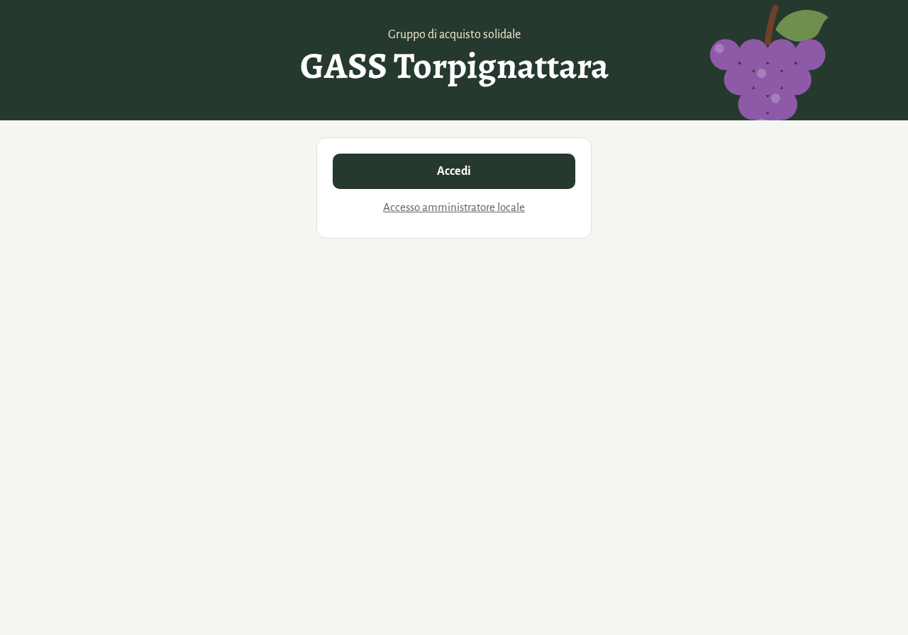
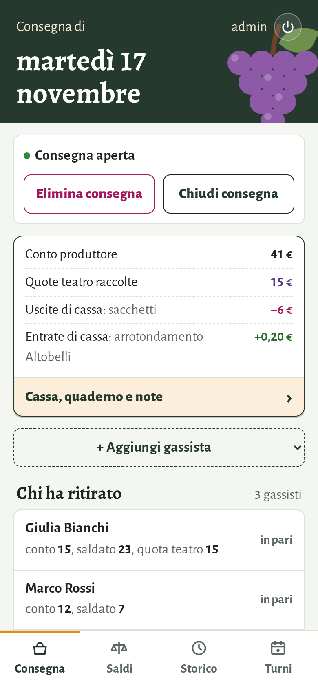
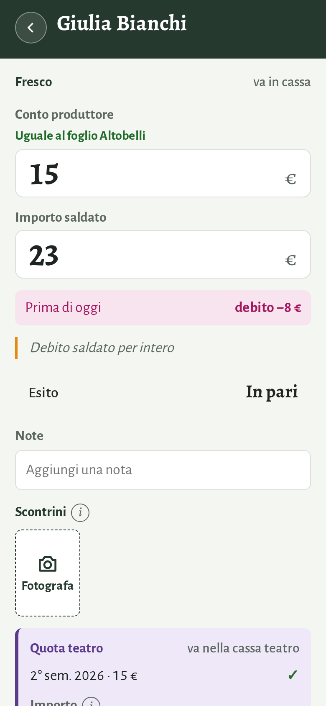
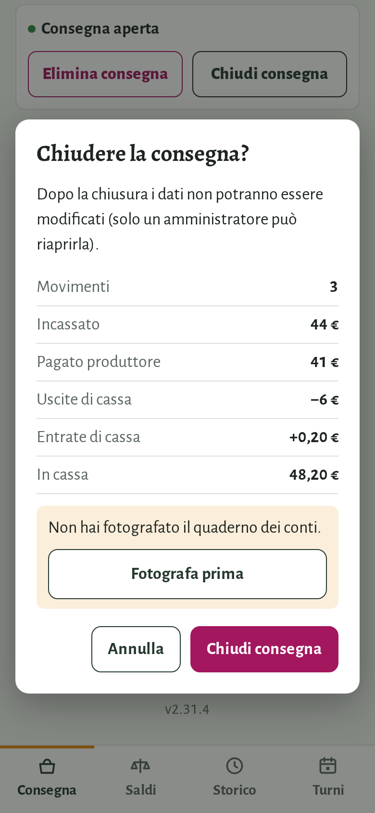
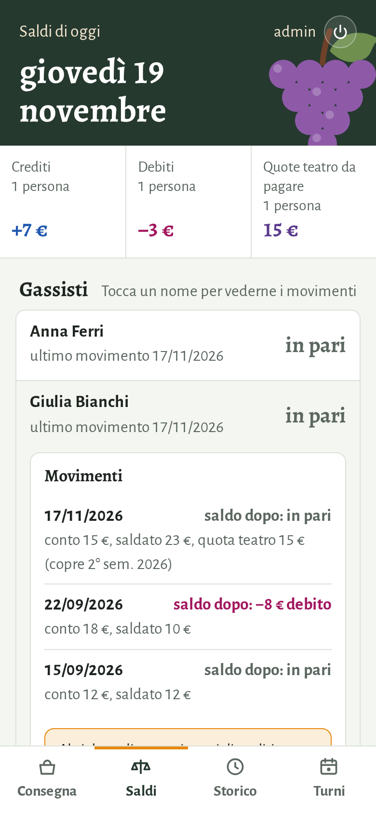
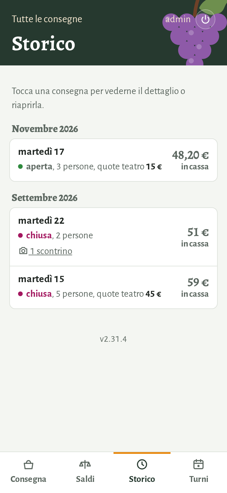

# Accesso

Apri il browser e vai su **https://gass.x86.it**. Clicca **Accedi** e inserisci nome utente e password. Al primo accesso usa la password provvisoria ricevuta: GASS ti chiede di sceglierne una nuova (almeno 8 caratteri).

Video del primo accesso (con i turni): **https://gass.x86.it/comefunziona**.

Per cambiare la password in seguito vai su **https://auth.x86.it**, nelle impostazioni del tuo utente.

{ width=50% }

**Navigazione:** barra in basso con quattro schede — *Consegna*, *Saldi*, *Storico*, *Turni*. In alto compaiono il tuo nome, la chiave (cambia password, solo account locali) e l'icona di uscita (*Esci*). L'intestazione scura cambia colore con la stagione.

---

# Consegna

La pagina si apre da sola sull'ultimo giorno di turno fino a oggi, se non ha ancora una consegna o ce l'ha aperta; altrimenti su oggi. Se non esiste ancora una consegna, appare il pulsante **Nuova consegna**. In cima un riquadro avvisa delle altre consegne ancora aperte ("Sono ancora aperte le consegne di …", con le date come link). Le consegne passate si aprono da **Storico**.

In cima lo stato (*Consegna aperta* / *Consegna chiusa*) con **Elimina consegna** (solo amministratori) e **Chiudi consegna**. Sotto, un riquadro riepilogo: conto produttore, quote teatro e le entrate/uscite di cassa con il motivo. Toccalo (**Cassa, quaderno e note**) per aprire a tutto schermo la pagina **Cassa e note**: la cassa completa (Trovato, + Incassato, − Pagato, = In cassa, tutto calcolato), il riquadro *Quaderno* per la foto dei conti scritti a mano, le *Entrate/uscite di cassa* e le *Note della giornata*; **‹** torna alla pagina. Se qualcuno ha preso soldi dalla cassa per altro (es. quote portate al teatro) o ne ha rimessi dentro (es. ha pagato Altobelli 357 € invece di 357,20), lo scrive in *Entrate/uscite di cassa*: tocca *− esce* o *+ entra*, poi importo e motivo (**+** a destra per un'altra riga), e **Salva**. A consegna chiusa la cassa completa torna in cima alla pagina e il riepilogo mostra solo il pulsante **Cassa, quaderno e note**.

{ width=45% }

## Registrare un Movimento

1. Nella sezione **Chi ha ritirato** seleziona il **gassista** da **+ Aggiungi gassista** (per modificare un movimento già inserito, tocca la sua riga)
2. Si apre il modulo a tutto schermo — inserisci:
   - **Conto produttore** (l'importo effettivo nel foglio Altobelli)
   - **Importo saldato** (quanto porta oggi); sotto, la riga **Prima di oggi** mostra il credito o il debito che aveva
   - se c'è, la **Quota teatro** (vedi sotto)
3. Il sistema calcola automaticamente credito o debito residuo e lo mostra nel riquadro finale (*Lascia credito*, *Lascia debito* o *Esito: In pari*). Nell'elenco *Chi ha ritirato* ogni riga mostra conto, saldato e, quando c'è, *quota teatro* (debito saldato e credito usato sono nei Saldi dal computer); a consegna chiusa una riga apre la scheda in sola lettura; chi ha pagato solo la quota ha una riga *solo teatro*
4. Clicca **Salva movimento**

> Se il gassista ha debiti/crediti pregressi, vengono compensati automaticamente.

{ width=45% }

## Chiudere la Consegna

Dopo aver salvato almeno un movimento, in cima alla pagina compare il pulsante **Chiudi consegna** — cliccalo e conferma il riepilogo per bloccare la giornata. Solo un amministratore può riaprirla: la apre da **Storico** e usa **Riapri consegna** qui. Se la cassa è negativa compare l'avviso "Cassa negativa": controlla i movimenti prima di chiudere.

{ width=45% }

---

# Saldi

In cima i totali dei crediti e dei debiti, poi la lista **Gassisti** con il saldo attuale. **+** blu con "credito" = credito, **−** rosso vino con "debito" = debito, grigio "in pari".

**Tocca un nome** per vedere i **Movimenti** di quel gassista, ognuno con il *saldo dopo*. Sotto il nome, se c'è una quota teatro: *quota teatro: deve X €* oppure *quota teatro: anticipo X € per il …*.

{ width=45% }

---

# Storico

Indice delle consegne, raggruppate per mese e dalla più recente: per ognuna data, stato (aperta/chiusa), persone, quote teatro e cassa. Tocca una consegna per aprirla nella pagina Consegna (il tasto indietro riporta qui). Una cassa negativa è in rosso.

{ width=45% }

---

# Turni

I prossimi 6 mesi con i due turnisti di ogni consegna (martedì). La tua riga è segnata **TU**; **da coprire** = manca un turnista; **riunione** = riunione GASS. **Mostra turni passati** aggiunge gli ultimi 3 mesi.

Tocca la tua riga (o **Apri**): sotto i menu dei turnisti compare **Il tuo turno** con **scambia con…** (prima mettiti d'accordo con qualcuno: prende il tuo turno e tu il suo primo turno da oggi), **sposta al…** (una data con un posto libero) e **Salta turno** (il posto resta da coprire). Ogni azione chiede conferma. Se ci sono, le **Note** sui turni compaiono sopra l'elenco. Gli altri turni si modificano da desktop.

---

# Quota teatro

Ogni semestre (gennaio–giugno, luglio–dicembre) si paga una quota per l'affitto del teatro, in una cassa separata da quella della consegna. Nella scheda del gassista, sotto i campi della spesa, il riquadro **Quota teatro** (va nella cassa teatro) mostra i semestri dovuti: scrivi la quota in **Importo** (copre i semestri dal più vecchio; quello che avanza è un anticipo). Se non deve nulla c'è il link **+ Quota teatro (anticipo)**. Si salva con lo stesso **Salva movimento**; il riepilogo *Ha dato in tutto X €* somma importo saldato e quota. In **Saldi**, sotto ogni nome, la situazione della quota.

---

# Solo per Amministratori

| Funzione | Come accedervi |
|---|---|
| Riaprire consegna chiusa | Storico → tocca la consegna → **Riapri consegna** |
| Eliminare una consegna salvata | Consegna → **Elimina consegna** |
| Modificare un saldo | dal computer: Saldi → **Modifica utente** |
